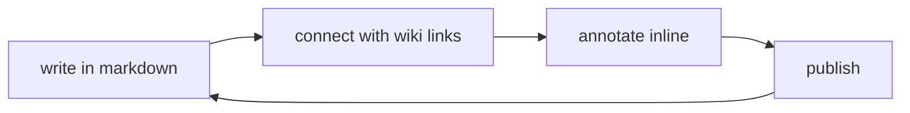

a place where plain markdown files become a calm, connected knowledge site.

quire.wiki turns your `/content` folder into a living notebook — with {hl:sage|wiki links}, {hl:blue|backlinks}, {hl:yellow|annotations}, diagrams, folders, tags, and graph relationships. write in any text editor. publish beautifully.

---

## why quire.wiki

- {ul:solid|write in plain markdown} — no proprietary format, no lock-in
- organize with folders — the sidebar tree builds itself from your file structure
- connect notes with `[[wiki links]]` — hover any link to preview the destination
- explore backlinks in the right panel — see everything that references a page
- annotate inline — highlights, underlines, folds, callouts
- own your files — everything lives in `/content`, portable forever

---

## quick start

1. open the `/content` folder in any text editor
2. edit or replace this `index.md` file with your own homepage
3. add more `.md` files — they appear in the sidebar automatically
4. connect pages with `[[wiki links]]`
5. annotate with `{hl:yellow|highlights}` and `{ul:wavy|underlines}`
6. hit publish when ready

---

## what's already here

this install includes a few starter notes. hover any link to preview before opening:

- [[feature showcase]] — a live demonstration of every syntax feature
- [[annotation guide]] — the complete markup reference
- [[learning]] — principles for acquiring knowledge that sticks
- [[memory]] — how the brain stores, forgets, and retrieves

---

## how linking works

quire.wiki distinguishes three kinds of links, each with its own visual register.

**wiki links** connect pages inside the garden. write `[[page title]]` anywhere in a note. broken links appear faded — they're placeholders for pages not yet written.

**hover previews** appear when you hold still over any internal link — wiki link or otherwise. you see the title and a brief excerpt without leaving the page.

**backlinks** are automatic. if note A links to note B, note B's right sidebar shows A under "referenced by." no configuration needed.

---

## annotation system

quire.wiki supports a small vocabulary of inline marks, designed to feel like pen annotations on paper — not word processor formatting.

{hl:yellow|yellow — warm, attentional, primary emphasis}

{hl:sage|sage — grounded, systemic, ecological thinking}

{hl:blue|blue — analytical, definitional, precise}

{hl:pink|pink — speculative, tender, soft hypothesis}

{hl:orange|orange — urgent, open question, flag}

{hl:gray|gray — aside, caveat, low confidence}

underlines carry their own register: {ul:solid|solid is a firm mark}. {ul:wavy|wavy signals uncertainty}. {ul:dashed|dashed means defer}. {ul:dotted|dotted is the quietest signal}.

you can combine them: {hl:blue ul:wavy|an analytical frame that still feels uncertain}.

---

## fold syntax

a fold lets you nest hidden content inline without fragmenting the prose. the visible part becomes a link. the hidden part opens on click.

this note was built by {fold: a calm process | start with a single file. add one link. notice what it connects to. add another file. the structure emerges from the writing, not the other way around.}

use folds for definitions, digressions, and anything that belongs but doesn't need to be read every time.

---

## collapsible sections

:::branch on the design of this system
quire.wiki doesn't try to be an outliner, a database, or a project manager. it is designed to hold networked prose — text that links, references, and annotates without requiring a formal schema.

the markup vocabulary is intentionally small: a few highlight colors, a few underline styles, links that preview before you follow them, diagrams that render in place. that's the whole system.

the simplicity is the feature.
:::

---

## diagrams

fenced code blocks marked `mermaid` render live diagrams inline. write the source, see the result. no exporting, no external editor.

---

## callout blocks

:::tip
add a new file anywhere in `/content` and it appears immediately in the sidebar. folder structure is inferred from the file path — no configuration.
:::

:::note
this homepage (`index.md`) is just a regular markdown file. you can replace it entirely with your own index, journal, portfolio, or documentation hub. quire.wiki doesn't care what the page says — it just renders it.
:::

---

## philosophy

> knowledge grows through revision, connection, and return. a good notebook is not finished. it stays alive.

the most useful notes are the ones you keep coming back to — not because they're complete, but because they're connected. a note without links is an island. a note with three good links is part of something larger.

write {hl:sage|to think}, not to archive. the act of linking is the act of understanding.

---

## create your own system

this page is a starting point, not a template. replace it with whatever index makes sense for your work:

- a **second brain** — interconnected notes on everything you read and think
- a **research garden** — literature notes, concepts, open questions
- a **journal** — dated entries, reflections, fragments
- a **documentation hub** — guides, references, runbooks
- a **portfolio** — projects, writing, work in progress

quire.wiki doesn't impose structure. it follows yours.

---

*built with quire.wiki*
