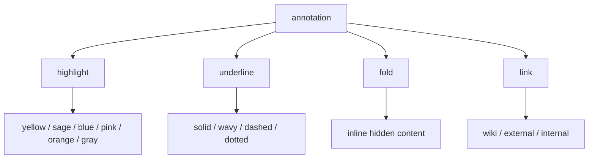

quire.wiki supports a small vocabulary of inline markup. these are not word-processor features. they are {hl:sage|marginalia} — marks that exist alongside the prose without disrupting it.

## highlights

highlights look like muted marker strokes on a cream page. use them to layer meaning without changing the weight of the prose.

{hl:yellow|yellow is warm and attentional} — good for primary emphasis and main ideas worth returning to.

{hl:sage|sage reads as ecological, grounded} — use it for things connected to systems, nature, and process.

{hl:blue|blue suggests something coolly analytical} — good for definitions, key terms, and formal concepts.

{hl:pink|pink is tender and uncertain} — good for speculative ideas, feelings, or soft hypotheses.

{hl:orange|orange carries urgency without aggression} — useful for warnings, time-sensitive notes, open questions.

{hl:gray|gray is the quietest highlight} — use it for asides, caveats, or content you're not sure belongs.

## underlines

underlines feel like marks made in the margin. each style has a different emotional register.

{ul:solid|a solid underline is a firm editorial mark} — straightforward emphasis, no ambiguity.

{ul:wavy|a wavy underline means uncertainty} — flag this, revisit it, it might be wrong.

{ul:dashed|dashed underline means defer} — you want to come back to this but not right now.

{ul:dotted|a dotted underline is the quietest signal} — a whisper, a soft marker, a quiet note to yourself.

## combinations

you can combine a highlight and underline on the same span:

{hl:yellow ul:dashed|important but needs more work} — lit up as significant, marked for return.

{hl:blue ul:wavy|analytical frame that feels uncertain} — confident enough to highlight, uncertain enough to flag.

{hl:sage ul:dotted|a grounded idea held gently} — present, not urgent.

{hl:pink ul:solid|a tender claim, firmly stated} — the underline commits to what the highlight softens.

{hl:orange ul:wavy|urgent and unstable} — something that demands attention but isn't yet settled.

## links

quire.wiki distinguishes three kinds of links, each with its own visual signature.

**wiki links** connect pages within the garden. hover to preview the destination before navigating.

a note like this one links back to the [[feature showcase]] and to [[learning]]. broken links appear faded like [[a page that does not exist yet]].

**external links** point outward. they carry a small arrow to signal departure — like visiting [Wikipedia](https://wikipedia.org) or [are.na](https://are.na).

**internal path links** use standard markdown syntax for [linking within the site](/note/notes/memory) without the wiki double-bracket syntax.

## fold syntax

a fold lets you nest hidden content inline without breaking prose flow. click the superscript indicator to reveal.

this sentence contains {fold: a fold | the hidden part of this thought — something you only see when you choose to look} that reveals on click.

folds are useful for definitions, parenthetical asides, or content that belongs but doesn't need to be visible all the time.

## callout blocks

:::note
a note callout. use it for contextual information, gentle caveats, or secondary thoughts that shouldn't interrupt the main prose.
:::

:::warning
a warning block. use it for things that might break, change, or mislead if not read carefully.
:::

:::tip
a tip block. use it for practical shortcuts, recommendations, or things that make the work easier.
:::

use a plain `:::card` block for neutral containers with no label:

:::card
an unlabeled card. clean container, no type signal — just structure.
:::

## collapsible sections

:::branch aside note
this content is hidden until expanded. use branch blocks for supplementary material, tangents, raw notes, or anything that belongs in the document but doesn't need to be read in flow.

it supports full **markdown** inside: lists, links, even {hl:blue|highlights}.
:::

## diagrams

quire.wiki renders mermaid diagrams inline. write a fenced code block with the language `mermaid` and it becomes a live diagram — no exporting, no external editor.



diagrams adapt to the current reading mode — light for standard, dark for dark mode.

## syntax reference

```
highlights
{hl:yellow|text}    {hl:sage|text}    {hl:blue|text}
{hl:pink|text}      {hl:orange|text}  {hl:gray|text}

underlines
{ul:solid|text}     {ul:wavy|text}
{ul:dashed|text}    {ul:dotted|text}

combinations
{hl:yellow ul:dashed|text}
{hl:blue ul:wavy|text}

fold
{fold: visible label | hidden content}

wiki link
[[page title]]
[[page title|display text]]

external link
[label](https://url)

callout blocks
:::note  :::warning  :::tip  :::card

collapsible
:::branch label text
content
:::
```

## design intent

these marks are not formatting for its own sake. the highlight colors are pulled from the same muted palette as the rest of the site. nothing neon. nothing loud. just {ul:dotted|quiet signal layered on quiet ground}.

use them {hl:yellow ul:solid|when a plain sentence isn't quite enough} — and nowhere else.
