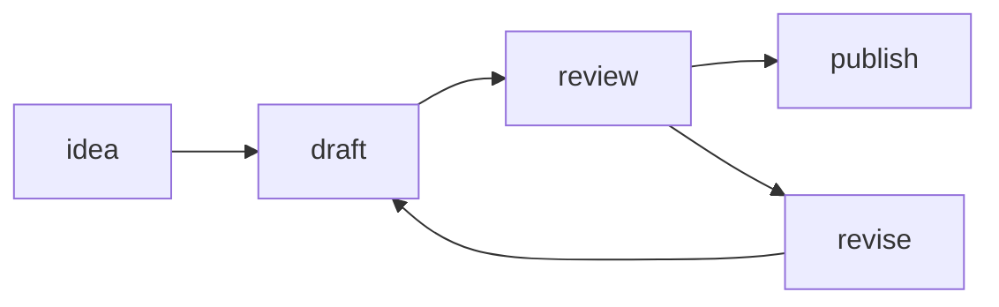
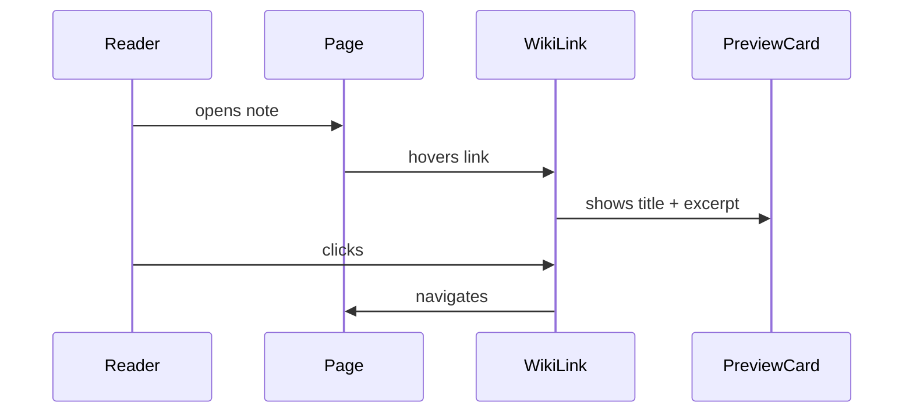
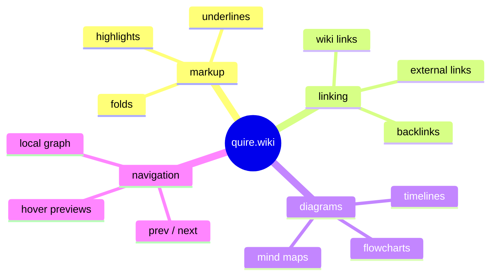
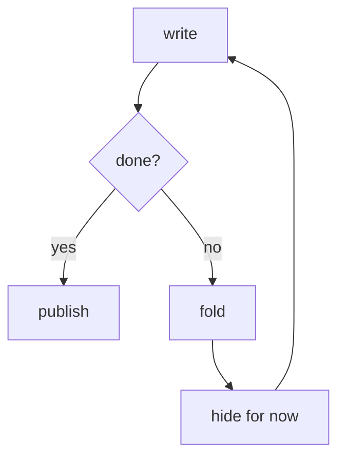
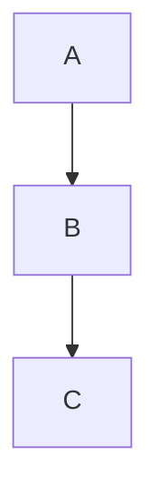

this page is a complete preview of what quire.wiki can do. read it as a reference, a test document, or a starting point for your own writing.

---

## typography

prose uses a serif reading font at a comfortable measure. **bold text** for emphasis. *italics* for titles, foreign terms, or soft stress. inline `code` for technical terms or values.

headings are set in the same serif at light weight — they guide without dominating.

### heading level three

a slightly smaller anchor for subsections within a major section.

#### heading level four

used sparingly, for deeply nested outlines or long technical documents.

---

## highlights

six muted marker colors, each with a different register:

{hl:yellow|yellow — warm, attentional, primary emphasis}

{hl:sage|sage — grounded, systemic, ecological}

{hl:blue|blue — analytical, definitional, precise}

{hl:pink|pink — speculative, tender, soft hypothesis}

{hl:orange|orange — urgent, open question, flag}

{hl:gray|gray — aside, caveat, low-confidence}

---

## underlines

four underline styles with distinct emotional weights:

{ul:solid|solid — firm editorial mark, no ambiguity}

{ul:wavy|wavy — uncertainty, revisit this, might be wrong}

{ul:dashed|dashed — deferred, not now but soon}

{ul:dotted|dotted — the quietest signal, a whisper to yourself}

---

## combinations

a highlight and underline can be stacked on the same span:

{hl:yellow ul:solid|primary claim, firmly stated}

{hl:blue ul:wavy|analytical frame that feels uncertain}

{hl:sage ul:dotted|a grounded idea held loosely}

{hl:pink ul:dashed|speculative thought, deferred}

{hl:orange ul:wavy|urgent and still unsettled}

{hl:gray ul:dotted|a quiet aside, barely there}

---

## links

**wiki links** connect pages inside the garden. hover any of these to see a preview card:

- [[annotation guide]] — the markup reference
- [[learning]] — notes on how learning works
- [[memory]] — notes on memory and retention
- [[a page that does not exist]] — broken links appear faded

**external links** carry a small departure arrow:

- [are.na](https://are.na) — a research platform
- [Obsidian](https://obsidian.md) — a local-first markdown editor
- [The Brain](https://thebrain.com) — associative knowledge mapping

**internal path links** use standard markdown: [back to the annotation guide](/note/notes/annotations).

---

## fold syntax

a fold lets you bury content inline without fragmenting the page. click to expand.

some ideas are better held {fold: quietly | this is the quiet part — the parenthetical, the aside, the definition you only need once. folds keep it in the document without making it loud.} than announced.

use them for definitions, caveats, or the kind of aside that belongs but doesn't need to be read every time.

---

## callout blocks

:::note
notes give context. use them for background, gentle caveats, or secondary material that enriches the main text without interrupting it.
:::

:::warning
warnings signal risk. use them when something might break, mislead, or behave unexpectedly if the reader isn't careful.
:::

:::tip
tips offer shortcuts. use them for practical recommendations, things that make the work easier, or patterns worth repeating.
:::

:::card
a plain unlabeled card. no type signal — just structure and separation. good for examples, code companion text, or neutral containers.
:::

---

## collapsible sections

collapse long asides, raw notes, or supplementary material. the trigger line becomes the label.

:::branch on memory and annotation
annotation is a form of memory externalization. when you highlight or underline, you are creating a retrieval cue — a mark that signals to your future self: *this mattered*.

the specific color or style doesn't need a strict semantic rule. what matters is that it was {hl:yellow|deliberate}. the act of choosing creates the trace.

see also: [[memory]] for more on this pattern.
:::

:::branch on the design of this system
quire.wiki doesn't try to be a full outliner or database. it is designed to hold {hl:sage|networked prose} — text that links, references, and annotates without requiring a formal schema.

the markup vocabulary is intentionally small. a few highlight colors. a few underline styles. links that preview before you follow them. diagrams that render in place.

that's the whole system.
:::

---

## diagrams

mermaid diagrams render live inside the page. the source stays in markdown. no export, no editor switch.

### flowchart



### timeline / sequence



### mind map



### process tree



---

## blockquotes

> a garden is not a collection of finished thoughts. it is a practice of tending to ideas over time.

> the best notebooks are the ones you keep returning to — not because they are complete, but because they are alive.

---

## lists

an unordered list of features:

- inline annotations: highlights, underlines, folds
- wiki links with hover previews
- mermaid diagram rendering
- collapsible branch blocks
- callout cards: note, warning, tip
- prev/next page navigation
- backlinks panel in the right sidebar
- full-text search in the sidebar
- local graph view
- dark mode toggle

an ordered sequence:

1. write in plain markdown
2. add wiki links with `[[double brackets]]`
3. annotate with highlight and underline syntax
4. publish — the graph builds itself

---

## code

inline: use `{hl:yellow|text}` for highlights and `{ul:wavy|text}` for underlines.

a fenced block:

```
{hl:sage ul:dotted|a grounded idea held gently}
[[wiki link|display text]]
{fold: label | hidden content}
```

a mermaid block:

```

```

---

## horizontal rule

three dashes make a visual pause between sections.

---

## putting it together

a real paragraph using the full system:

{hl:blue|networked thinking} is not about having more notes — it is about having {hl:sage ul:dotted|better connections between them}. the value of a note is proportional to how many other notes it touches. see [[memory]] for the longer version of this argument.

{hl:yellow|annotation} is a form of attention. it says: {fold: this mattered | and because it mattered, i marked it — so that some future version of me, scrolling through months of notes, would pause here}. the mark is not for the prose. it is for the reader.

---

*this page is a living reference. it will grow as the system grows.*
